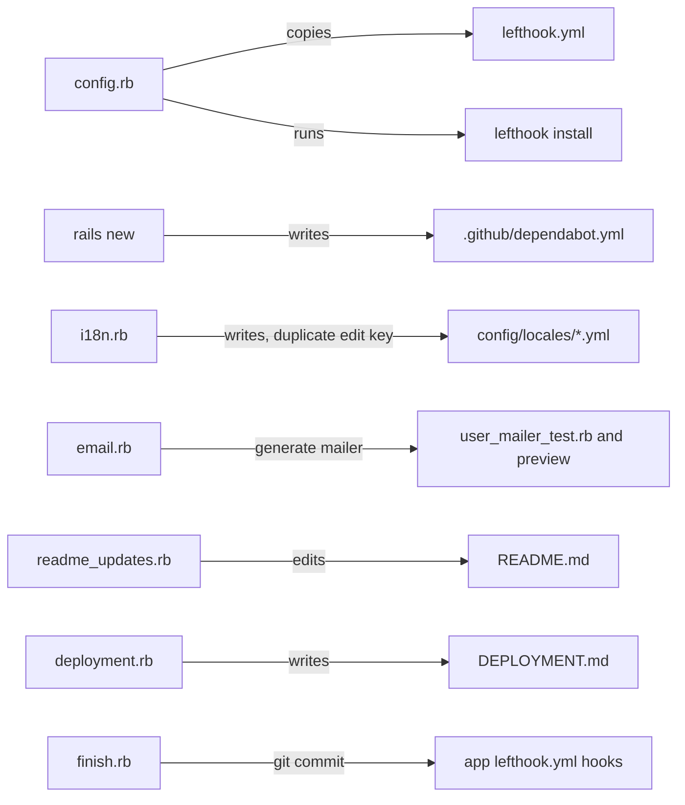
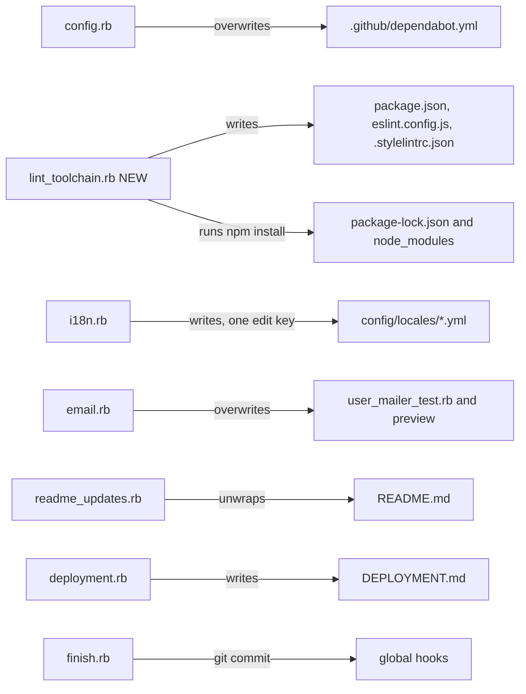

# Plan: New apps get their RuboCop rules from the shared standard

From `intent.md` (amended 2026-10-30). Status: accepted.

## Context

This plan replaces the plan of 2026-10-16. That plan covered the RuboCop part of the intent, and the branch already holds it: `31e6664` (generated `.rubocop.yml` inherits `rubocop-eirvandelden`, Gemfile changes, `test/config_template_test.rb`, `test/gems_template_test.rb`), the offense fixes `4874312`, `1ff9fd0`, `c5fdf6c`, `2cc1d77`, and the `UPGRADING.md` chapter `## 31e6664 — Take RuboCop rules from rubocop-eirvandelden` (`98dc00a`). Review round 1 found that generation still exits 1 at the initial `git commit`. The intent was amended on 2026-10-17 and 2026-10-30 to cover the git hooks, a JS and CSS lint toolchain, and the mailer tests. This plan covers that remaining work. Do not redo or revert the done work.

Facts checked while planning (2026-10-30):

- `git config --global core.hooksPath` is `~/.config/git/hooks`. Its `pre-commit` and `commit-msg` scripts run lefthook with `~/Developer/dotfiles/lefthook.yml` when the repository has no `lefthook.yml`, `.lefthook.yml` or `.config/lefthook.yml`. A repository that has one uses its own file instead.
- The global `no-push-to-main` jobs let the first commit on an unborn `main` through. Checked with a throwaway repository: commit exit 0.
- The global pre-commit jobs that can see a fresh app's staged files: `stylelint` (`npx --no stylelint`), `eslint` (`npx --no eslint`), `erb_lint`, `rubocop -a` (with `stage_fixed`), `ruby-syntax`, `yamllint`, `no-hardwrap`, `no-fixme`, `no-nocommit`, `no-merge-conflicts`, `no-debugger-ruby`, `no-debugger-js` (`console.log`). `no-hardwrap` ends with `exit 0`, so it reports but never fails the commit.
- yamllint with the global config rejects Rails 8.1.4's generated `.github/dependabot.yml` (unindented sequences). It also rejects the template's three locale files: `template/i18n.rb` writes two `edit:` keys under `admin.users` in `en.yml`, `nl.yml` and `it.yml` (`key-duplicates`, output line 80). Psych keeps the second block, so the first is dead today. `app/views/admin/users/edit.html.erb` uses only `.title` and `.submit`, which the second block holds.
- markdownlint with the `no-hardwrap` rule flags: `README.md` lines 3–4 (Rails' default intro), `README.md` lines 86–92 (SQLite bullets from `template/readme_updates.rb`), `DEPLOYMENT.md` lines 118–119 (SSL paragraph from `template/deployment.rb`). The three `README.md` files under `lib/` and `app/validators/` pass.
- The generated CSS (`application.css` after the `appkit.rb` substitution, `themes/brand.css`) passes `stylelint-config-standard` 40.0.0 with stylelint 17.15.0. That config sets `import-notation: url`, which matches the template's `@import url(...)`. Propshaft 1.3.2 digests only `url(...)` references, so `url()` must stay.
- The generated JS (stimulus-rails 1.3.4 installer files, `appkit.rb` additions) passes ESLint 10.8.1 with `@eslint/js` 10.0.1 recommended once `window` is a declared global. Without that declaration, `app/javascript/controllers/application.js:7` fails `no-undef`.
- `template/email.rb` rewrites `UserMailer` as `welcome(user)` and `password_reset(user, token)`. The generated `test/mailers/user_mailer_test.rb` and `test/mailers/previews/user_mailer_preview.rb` call both with no arguments. The `password_reset` views call `edit_password_reset_url(@token)`. No such route exists: not in `template/routes.rb`, and not in the appkit engine's `config/routes.rb` (appkit `4c82e2e`). So `password_reset` cannot render, whatever the arguments.
- Rails generators set `exit_on_failure?` to false, so Thor's `run` does not abort on a failing command unless the call passes `abort_on_failure: true`.

## Design

### Domain terms

No `GLOSSARY.md` exists in this repository. Terms used here, from `intent.md` and `CLAUDE.md`:

- **Template module**: one `template/*.rb` file that `template.rb` applies, in apply order.
- **Fresh app**: an app that `rails new <name> -m template.rb` has just generated.
- **Global hooks**: lefthook run through the global `core.hooksPath` with the dotfiles `lefthook.yml`.
- **Lint toolchain** (new): the fresh app's `package.json`, `package-lock.json`, `eslint.config.js` and `.stylelintrc.json`, which the global `eslint` and `stylelint` hooks need.
- **Recorder**: a test double that `instance_eval`s a template module and records its DSL calls (existing pattern in `test/*_template_test.rb`).

### Diagrams

Before: which template module writes which hook-checked file.



After:



Apply order after the change (only the touched part): `… email → css → appkit → config → lint_toolchain → deployment → seeds → readme_updates → finish`.

### Signatures

The template modules are DSL scripts with no classes or methods. Their interface is the DSL calls they make and the files they write.

`template/config.rb` — writes the fresh app's configuration files.

- Removes the "Copy lefthook configuration from template" block and `run "bundle exec lefthook install"`.
- Adds `create_file ".github/dependabot.yml", <<~YAML, force: true` with exactly this content:

  ```yaml
  ---
  version: 2
  updates:
    - package-ecosystem: bundler
      directory: "/"
      schedule:
        interval: weekly
      cooldown:
        default-days: 7

    - package-ecosystem: npm
      directory: "/"
      schedule:
        interval: weekly
      cooldown:
        default-days: 7

    - package-ecosystem: github-actions
      directory: "/"
      schedule:
        interval: weekly
      cooldown:
        default-days: 7
  ```

`template/lint_toolchain.rb` (new) — gives the fresh app the JS and CSS lint toolchain that the global hooks run.

- Starts with `require "json"`: neither the recorder tests nor every Thor context loads JSON.
- `create_file "package.json"` with `JSON.pretty_generate({ "name" => app_name, "private" => true, "type" => "module" }) + "\n"`.
- `create_file "eslint.config.js"`:

  ```js
  import js from "@eslint/js"

  export default [
    { ignores: ["vendor/**", "public/**", "tmp/**"] },
    js.configs.recommended,
    {
      languageOptions: {
        globals: { window: "readonly" }
      }
    }
  ]
  ```

- `create_file ".stylelintrc.json"`: `{ "extends": ["stylelint-config-standard"], "ignoreFiles": ["vendor/**", "public/**", "tmp/**"] }`, pretty-printed.
- `append_to_file ".gitignore", "\n# npm\n/node_modules\n"`.
- `run "npm install --save-dev eslint @eslint/js stylelint stylelint-config-standard", abort_on_failure: true`. npm adds `devDependencies` with caret ranges of the current majors to `package.json` and writes `package-lock.json`.
- `say` lines in the style of the other modules.

`template.rb` — adds `apply "#{TEMPLATE_ROOT}/template/lint_toolchain.rb"` directly after the `config.rb` line.

`template/email.rb` — writes the user mails and their test.

- `generate :mailer`, the rewritten `UserMailer` and all four views stay as they are.
- Adds `create_file "test/mailers/user_mailer_test.rb", <<~RUBY, force: true`:

  ```ruby
  require "test_helper"

  class UserMailerTest < ActionMailer::TestCase
    test "welcome" do
      user = users(:user)
      mail = UserMailer.welcome(user)

      assert_equal "Welcome to #{Rails.application.class.module_parent_name}!", mail.subject
      assert_equal [ user.email ], mail.to
      assert_match user.email, mail.body.encoded
    end
  end
  ```

  The heredoc escapes the interpolation as `\#{`, as the existing mailer heredoc does.
- The generated test has no `password_reset` test: that mail cannot render (no `edit_password_reset_url` route), so no correct call of it can pass.
- Adds `create_file "test/mailers/previews/user_mailer_preview.rb", <<~RUBY, force: true`: `UserMailerPreview < ActionMailer::Preview` with `def welcome` returning `UserMailer.welcome(User.first)` and `def password_reset` returning `UserMailer.password_reset(User.first, "preview-token")`, keeping Rails' "Preview … at http://localhost:3000/rails/mailers/…" comments. The preview calls each action with the arguments it takes; the `password_reset` preview still fails to render until the route question is settled.

`template/i18n.rb` — removes the first (shadowed) `edit:` block under `admin.users` in each of the three locale heredocs: the block with `title`, `email`, `role`, `submit`, `cancel` that sits before `create:`. The second block (`title`, `submit`) stays, so runtime translations do not change.

`template/readme_updates.rb` — before `File.write`, joins Rails' intro over any whitespace: `readme.sub!(/^This README would normally document.*?running\./m) { |intro| intro.gsub(/\s*\n\s*/, " ") }`. Puts each SQLite bullet in the `### SQLite` heredoc on one line.

`template/deployment.rb` — joins "Kamal can automatically provision SSL certificates using Let's Encrypt." and "Configure this in `config/deploy.yml` under the `traefik` section." into one line.

`template/finish.rb` — replaces the summary line `"✅ Lefthook git hooks"` with `"✅ ESLint and Stylelint configuration"`.

Not checked: this repository has no Gemfile and its template modules define no methods, so there is nothing for Steep to check.

### Complexity

- Generation gains one `npm install` (one registry resolution plus downloads of four packages and their dependencies; needs network, Node and npm) and four `create_file` calls. It loses one `bundle exec lefthook install`.
- The initial `git commit` now runs the global hooks over every staged file. The heavy jobs are `rubocop -a` and `erb_lint` over the whole app, once.
- No database path, no query, no loop over input.

### Invariants

- A fresh app has no `lefthook.yml`, so the global hooks apply to it. Enforced by `template/config.rb` writing none. Proved by `test/config_template_test.rb` `test_config_writes_no_lefthook_file`.
- `npm install` finishes before `finish.rb`'s `git add .`, and generation stops if it fails. Enforced by apply order in `template.rb` and `abort_on_failure: true`. Proved by `test/lint_toolchain_template_test.rb` `test_lint_toolchain_runs_after_config_and_before_finish` and `test_npm_install_aborts_generation_on_failure`.
- The npm dev dependencies are exactly the four approved packages. Enforced by the single `run` string. Proved by `test_npm_install_adds_exactly_the_four_approved_dev_dependencies`.
- Every locale file the template writes has unique keys per mapping. Enforced by `template/i18n.rb`. Proved by `test/i18n_template_test.rb` `test_locale_files_have_no_duplicate_keys`.
- The generated mailer test calls each mailer method with the arguments it takes. Enforced by `template/email.rb`. Proved by `test/email_template_test.rb` `test_mailer_test_calls_welcome_with_the_user_fixture`.

### Alternatives

- A. Smallest change: everything in existing modules, the lint toolchain in `config.rb`. Rejected: `config.rb` would own RuboCop, Dependabot, `.env`, Procfile, three npm files and a network install. The npm install is a separate step that can fail on its own, and it reads better as one module with one test file.
- B. Most cohesion: new `lint_toolchain.rb` and a new `dependabot.rb`, the mailer without `generate :mailer`. Rejected in part: a module for one static file is shallow, and dropping the generator rewrites more of `email.rb` than the bug needs. Kept from B: the `lint_toolchain.rb` module and the finish summary fix.
- Chosen: B's `lint_toolchain.rb` plus A's in-place fixes. Dependabot goes in `config.rb`, the module that writes the app's repository config files.

## Design decisions

- `intent.md` has no `## Decisions` section. Its dated decisions sit in `## Constraints` and `## Flagged concerns`. Every step below was checked against them: no `--no-verify` or `LEFTHOOK=0`, the global hooks stay unchanged, only the approved dependencies change, the recommended rule sets stay as they are.
- `eslint.config.js` declares `window` as a readonly global. This tells ESLint the browser environment that Stimulus code runs in. It is not a rule change: `no-undef` stays on, and every other undeclared name still fails. The other personal apps use the `globals` package (`globals.browser`) for this, but that package is not approved, so the template declares only the one global the generated JS uses. Raised as a decision for Etienne.
- `password_reset` stays in the generated mailer, and the generated mailer test covers `welcome` only. No route exists for the `password_reset` link, so that mail cannot render and no correct test of it can pass. Removing the action, or adding a route, would change generated behaviour that `intent.md` does not name, so the plan does neither and raises the choice as a decision for Etienne. If he picks removal, step 5 also drops the method, the two views and the generator argument, and its tests change to match.
- `npm install --save-dev <four packages>` writes the version ranges, instead of a `package.json` with ranges written by hand. The template then holds no version numbers nobody verified, in line with the unpinned gems in `template/gems.rb` and the `dependencies` skill. Dependabot keeps them current.
- `package.json` sets `"type": "module"`, so Node loads `eslint.config.js` as ESM without syntax detection.
- The Stylelint config is `.stylelintrc.json`: JSON needs no module loader, and ESLint does not lint it.
- `ignores`/`ignoreFiles` list `vendor/**` (third-party code, per the intent), `public/**` (precompiled assets) and `tmp/**`. ESLint and Stylelint skip `node_modules` by default.
- The Dependabot file follows the `dependencies` skill (all ecosystems, weekly, one-week cooldown) and matches the file in the other personal apps. It adds `npm`, because the fresh app now has a `package.json`.
- The duplicate locale key is fixed by deleting the shadowed block, not by merging. This keeps today's runtime translations exactly.
- The finish summary line "Lefthook git hooks" would be false once the app carries no lefthook config, so it names the lint configuration instead.
- `TEMPLATE_STRUCTURE.md` gets the new module in its tree and table, and the `config.rb` row drops "Lefthook". The repository `README.md` is not touched (see Out of scope).
- The `UPGRADING.md` chapter `## 31e6664` gets one sentence that names copies with `rubocop-rbs_inline`, made after 2026-10-13 (dotfiles `df0c7f5d`). Its steps already fix both plugins; only the applicability text changes. No new chapter: removing lefthook files from older apps is out of scope.
- No glossary terms are written: in auto mode no term gets Etienne's agreement.

## Integration points

- Rails' `rails new` generator and Thor actions (`create_file`, `append_to_file`, `run`, `generate`, `apply`).
- The global hooks: `~/.config/git/hooks/pre-commit` and `commit-msg`, `~/Developer/dotfiles/lefthook.yml`, the global yamllint config, `~/.config/markdownlint/no-hardwrap.*`.
- npm and the npm registry: `eslint`, `@eslint/js`, `stylelint`, `stylelint-config-standard`.
- GitHub Dependabot, which reads the generated `.github/dependabot.yml`.
- The appkit engine's routes, which have no password reset.
- Dotfiles history, for the upgrade check samples: `ec98f54c:rubocop/.rubocop.yml` (names `rubocop-yard`) and `df0c7f5d:rubocop/.rubocop.yml` (names `rubocop-rbs_inline`).

## Files that change

- `test/config_template_test.rb` — the recorder records `run` commands and `append_to_file` calls. New tests for the lefthook removal and the Dependabot file.
- `template/config.rb` — lefthook block and `lefthook install` removed; `.github/dependabot.yml` written.
- `test/lint_toolchain_template_test.rb` — new. Recorder with `app_name`, `create_file`, `append_to_file`, `run`, `say`.
- `template/lint_toolchain.rb` — new module.
- `template.rb` — applies `lint_toolchain.rb` after `config.rb`.
- `TEMPLATE_STRUCTURE.md` — new module in the tree and the module table; `config.rb` row updated.
- `test/finish_template_test.rb` — new summary test.
- `template/finish.rb` — summary line.
- `test/email_template_test.rb` — new. Recorder with `generate`, `create_file`, `remove_file`, `gsub_file`, `inject_into_file`, `say`.
- `template/email.rb` — welcome-only mailer; generated test and preview overwritten.
- `test/i18n_template_test.rb` — new. Recorder that captures the locale heredocs.
- `template/i18n.rb` — shadowed `edit:` blocks removed.
- `test/readme_updates_template_test.rb` — new. Recorder whose `destination_root` is a temporary directory holding Rails 8.1.4's default `README.md` text.
- `template/readme_updates.rb` — intro joined, SQLite bullets one line each.
- `test/deployment_template_test.rb` — new. Recorder that captures `DEPLOYMENT.md`.
- `template/deployment.rb` — SSL paragraph on one line.
- `UPGRADING.md` — one sentence in the `## 31e6664` chapter.

## Order of work

Each fix is a bug fix, so its test comes first and must fail before the fix. Each numbered step is its own commit, unless it says otherwise.

1. Walking skeleton for "a fresh app has no `lefthook.yml`": in `test/config_template_test.rb`, make `run` record its commands, then add `test_config_writes_no_lefthook_file` and `test_config_runs_no_lefthook_install`. Run `ruby test/config_template_test.rb`. Watch both fail. Remove the lefthook block and the install from `template/config.rb`. Run until green. Commit.
2. Add the three Dependabot tests to `test/config_template_test.rb`. Watch them fail. Add the `create_file` to `template/config.rb`. Green. Commit.
3. Write `test/lint_toolchain_template_test.rb`. Watch it fail (the module does not exist). Create `template/lint_toolchain.rb`, add its `apply` line to `template.rb`, update `TEMPLATE_STRUCTURE.md`. Green, and `ruby test/appkit_template_test.rb --exclude test_deleted_template_files_are_gone` and `ruby test/template_syntax_test.rb` stay green. Commit.
4. Add `test_summary_lists_the_lint_configuration` to `test/finish_template_test.rb`. Watch it fail. Change the line in `template/finish.rb`. Green. Commit.
5. Write `test/email_template_test.rb`. Watch it fail. Change `template/email.rb`. Green. Commit.
6. Write `test/i18n_template_test.rb`. Watch it fail on `admin.users.edit` in all three locales. Delete the shadowed blocks in `template/i18n.rb`. Green. Commit.
7. Write `test/readme_updates_template_test.rb`. Watch it fail. Fix `template/readme_updates.rb`. Green. Commit. Then the same for `test/deployment_template_test.rb` and `template/deployment.rb`, in its own commit.
8. Add the `rubocop-rbs_inline` sentence to the `## 31e6664` chapter of `UPGRADING.md`. Commit.
9. Run every test file, stopping at the first failing file (Minitest 6.0.6 has no `--fail-fast`), with only the known pre-existing failure excluded: `set -e; for f in test/*_test.rb; do if [ "$f" = test/appkit_template_test.rb ]; then ruby "$f" --exclude test_deleted_template_files_are_gone; else ruby "$f"; fi; done`. Run `rubocop` on every changed `.rb` file and `markdownlint --config ~/.config/markdownlint/no-hardwrap.json --rules ~/.config/markdownlint/no-hardwrap.cjs` on every changed `.md` file.
10. Manual generation run, with this machine's real global git config (no `GIT_CONFIG_GLOBAL` override). It needs network access for bundling and npm; run it outside the sandbox if the sandbox blocks the network.
    - `set -o pipefail`; `tmp=$(mktemp -d)`; `cd "$tmp"`; `rails new hooks_check -m <worktree>/template.rb < /dev/null 2>&1 | tee generation.log`. The pipeline must exit 0.
    - Expect the log to end with "🎊 Happy coding!". Expect a lefthook `pre-commit` summary in the log with no failed job, and `git -C hooks_check log --oneline` to show the initial commit.
    - In `$tmp/hooks_check`: `test ! -e lefthook.yml`; `npx --no eslint .` and `npx --no stylelint "**/*.css"` print no problems and exit 0; `bundle exec rubocop` prints "no offenses detected"; `bin/rails test` reports 0 failures and 0 errors; `yamllint .github/dependabot.yml config/locales/*.yml` exits 0; the `no-hardwrap` markdownlint command over `README.md DEPLOYMENT.md` exits 0; `cat .rubocop.yml` shows only the `inherit_gem` block; `grep -n rubocop Gemfile` shows `rubocop-eirvandelden` and `rubocop-capybara` and none of the four removed gems.
    - A hook job or check that still fails: when the cause is a template file and the fix stays inside `intent.md`, write a failing string test, fix the template module, commit, delete `$tmp/hooks_check`, regenerate. When a hook still fails for any other reason, stop and ask Etienne (intent constraint). Never pass `--no-verify` or `LEFTHOOK=0`.
    - Record the evidence (log tail, each check's output) for the review.
11. Manual upgrade check, in `$tmp/hooks_check`, once per sample: `ec98f54c` (`rubocop-yard`) and `df0c7f5d` (`rubocop-rbs_inline`).
    - `git -C ~/Developer/dotfiles show <sha>:rubocop/.rubocop.yml > .rubocop.yml`. In the `Gemfile`, remove the `rubocop-eirvandelden` line and put back the four plugin gem lines in `group :development, :test do`. Run `bi`. `bundle exec rubocop` must fail with `cannot load such file -- rubocop-yard` (or `-- rubocop-rbs_inline`).
    - Follow the `## 31e6664` chapter word for word. `bundle exec rubocop` must run without a load error.
    - Fix the chapter for any step that did not work as written, and commit the fix.
12. Re-run step 9. Re-read the full branch diff against `main` and revert any hunk the task does not need.
13. After any rebase onto `main`, check that the `## 31e6664` heading still names the commit that changes `template/config.rb` for RuboCop, and fix it if not.

## Risks

- `npm install --save-dev` picks the newest majors at generation time. A later major of ESLint, `@eslint/js`, Stylelint or `stylelint-config-standard` can flag generated JS or CSS, and the initial commit then fails. Step 10 catches it today; later it surfaces as a failing generation, the same class of failure as a new shared RuboCop cop.
- The global `rubocop` and `erb_lint` hooks run over every staged file with the global binaries. They passed in review round 1 with the same dotfiles config, but the dotfiles config changed since (`ec72c1e5`, npm instead of yarn). Step 10 rechecks them.
- Thor asks "Overwrite …?" when a module writes a file that already exists without `force: true`. `< /dev/null` answers yes, so step 10 cannot show such prompts. Record any "conflict" lines in `generation.log` in the evidence; fixing them is out of scope.
- `no-hardwrap` always exits 0, so a hard wrap never fails the commit. The step 10 markdownlint check is what proves the Markdown criterion.
- The hand-declared `window` global covers only today's generated JS. App code that uses `document` or other browser globals fails `no-undef` until the app owner declares them, or until the `globals` package is approved.
- The `password_reset` mail stays unrenderable and untested in a fresh app until Etienne decides its fate. This is pre-existing; the plan makes it visible, not worse.
- Rejected: copying the dotfiles `lefthook.yml` and fixing it. The intent says the app holds no copy.
- Rejected: `@import "x.css"` string notation. Propshaft would not digest it, and `stylelint-config-standard` 40 wants `url()` anyway.
- Rejected: merging the two locale `edit:` blocks. It would change today's runtime translations.

## Out of scope

- The global hooks in the dotfiles `lefthook.yml`.
- Installing Node or npm.
- The `lefthook` gem in the generated `Gemfile`, and the `.lefthook-local.yml` line in the generated `.gitignore`.
- Removing lefthook files from apps generated earlier.
- Ruby versions below 3.4.
- This repository's own `.rubocop.yml` and `lefthook.yml` symlinks.
- The `rubocop-eirvandelden` gem.
- Other gems in the generated `Gemfile`.
- `AppkitTemplateTest#test_deleted_template_files_are_gone` and `template/theme_system.rb`.
- The repository `README.md` (it still says "RuboCop (Omakase)" and "Lefthook"). A follow-up branch.
- Thor overwrite prompts for files the template writes over generator output without `force: true`.
- `DEPLOYMENT.md`'s reference to a `UserMailer.test_email` that does not exist.
- A password reset feature.

## Proof

- On this machine, with its global `core.hooksPath`, generation makes the initial commit through the global hooks and prints "🎊 Happy coding!" → check: Order of work step 10, `generation.log` ends with "🎊 Happy coding!", shows the lefthook `pre-commit` summary with no failed job, and `git log` shows the commit. `test/finish_template_test.rb` `test_finish_step_runs_to_the_end_of_the_summary` keeps covering the summary text.
- A fresh app has no `lefthook.yml` → `test/config_template_test.rb` `test_config_writes_no_lefthook_file`, plus check: step 10, `test ! -e lefthook.yml`.
- In a fresh app, `npx --no eslint .` and `npx --no stylelint "**/*.css"` report no problems → check: step 10, both commands exit 0 with no output; `test/lint_toolchain_template_test.rb` pins the configs.
- A fresh app's `bundle exec rubocop` reports no offenses → check: step 10.
- A fresh app's `bin/rails test` passes with no failures or errors → check: step 10; `test/email_template_test.rb` `test_mailer_test_calls_welcome_with_the_user_fixture`.
- A fresh app's `.rubocop.yml` inherits the three layers and holds no copied rules → `test/config_template_test.rb` `test_rubocop_config_inherits_the_three_layers_from_rubocop_eirvandelden` (exists), plus check: step 10.
- A fresh app's `Gemfile` names `rubocop-eirvandelden` and `rubocop-capybara`, and none of the four plugin gems → `test/gems_template_test.rb` `test_gemfile_takes_rubocop_rules_from_rubocop_eirvandelden`, `test_gemfile_keeps_rubocop_capybara`, `test_gemfile_drops_plugin_gems_rubocop_eirvandelden_brings` (exist), plus check: step 10.
- An app with a copied `.rubocop.yml` that names `rubocop-yard` or `rubocop-rbs_inline` runs `bundle exec rubocop` without a load error after the chapter → check: step 11, both samples.
- Query count: not affected; the change has no database path.
- Invariant: `npm install` runs before `git add .` and stops generation on failure, enforced by apply order and `abort_on_failure: true` → `test/lint_toolchain_template_test.rb` `test_lint_toolchain_runs_after_config_and_before_finish`, `test_npm_install_aborts_generation_on_failure`.
- Invariant: the generated locale files have unique keys, enforced by `template/i18n.rb` → `test/i18n_template_test.rb` `test_locale_files_have_no_duplicate_keys`.

Per changed file, the unit tests expected:

- `test/config_template_test.rb`: `test_config_writes_no_lefthook_file`, `test_config_runs_no_lefthook_install`, `test_dependabot_covers_bundler_npm_and_github_actions_weekly_with_a_seven_day_cooldown` (YAML-parsed content equals the expected hash), `test_dependabot_indents_sequences_and_starts_with_a_document_marker` (content starts with `"---\n"` and holds `"\n  - package-ecosystem: bundler\n"`), `test_dependabot_overwrites_the_rails_generated_file` (`force: true`).
- `test/lint_toolchain_template_test.rb`: `test_package_json_is_a_private_module_named_after_the_app`, `test_npm_install_adds_exactly_the_four_approved_dev_dependencies`, `test_npm_install_aborts_generation_on_failure`, `test_eslint_config_uses_the_recommended_rules`, `test_eslint_config_declares_window_as_a_readonly_global`, `test_eslint_config_ignores_vendor_public_and_tmp`, `test_stylelint_config_extends_standard_and_ignores_vendor_public_and_tmp`, `test_gitignore_ignores_node_modules`, `test_lint_toolchain_runs_after_config_and_before_finish`.
- `test/finish_template_test.rb`: `test_summary_lists_the_lint_configuration` (holds "✅ ESLint and Stylelint configuration", not "✅ Lefthook git hooks").
- `test/email_template_test.rb`: `test_mailer_test_calls_welcome_with_the_user_fixture`, `test_mailer_test_overwrites_the_generated_file` (`force: true`), `test_mailer_preview_calls_each_action_with_its_arguments`, `test_mailer_preview_overwrites_the_generated_file`.
- `test/i18n_template_test.rb`: `test_locale_files_have_no_duplicate_keys` (walks `Psych.parse` mapping nodes of `en.yml`, `nl.yml`, `it.yml`), `test_admin_user_edit_keeps_its_title_and_submit`.
- `test/readme_updates_template_test.rb`: `test_readme_intro_is_one_line`, `test_readme_sqlite_bullets_are_one_line_each`.
- `test/deployment_template_test.rb`: `test_deployment_ssl_paragraph_is_one_line`.

Test setup: plain Minitest scripts, as in `test/config_template_test.rb`. Each new test file defines a recorder that `instance_eval`s one module and stubs only the DSL calls that module makes. The `lint_toolchain` recorder returns `"demo_app"` from `app_name`. The `readme_updates` recorder writes Rails 8.1.4's default `README.md` text (a string constant in the test) into a `Dir.mktmpdir` and reads the result back. Apply-order tests scan `template.rb` as `test/appkit_template_test.rb` does. No network, no Rails, no npm, no bundling in the automated tests.

---
Domain skills applied: dependencies (approved npm packages only, npm not yarn, unpinned versions, Dependabot policy), rails-testing (Minitest, recorder-style tests matching the repository), software-design (two architects, alternatives, invariants), diagrams (before and after flowcharts), new-repo-setup (no lefthook files, no `lefthook install`), rails-ui (Propshaft `url()` imports kept).

## Critique

### Round 1 (codex exec -p terra)

- `JSON.pretty_generate` fails in the recorder test, because neither Ruby nor Minitest preloads `JSON` → fixed (`template/lint_toolchain.rb` starts with `require "json"`)
- Removing `password_reset` changes generated app behaviour beyond the intent, which asks only for a green mailer test suite → fixed (the action and views stay; the generated test covers `welcome`, the preview calls both actions with their arguments, and removal is raised as a decision for Etienne)
- Unpinned `npm install` makes generation depend on future major releases; generate exact tested versions instead → dismissed: the `dependencies` skill says not to pin by default, the template's gems are unpinned too, and exact versions in the template would go stale with no Dependabot to bump them, so each new app would start outdated
- The step 9 test command claims to stop at the first failure but passes no `--fail-fast` → fixed (wording now says it stops at the first failing file; Minitest 6.0.6 rejects `--fail-fast` as an invalid option, checked locally)
- The `rails new | tee` pipeline lacks `set -o pipefail`, so a failed generation can look successful → fixed (step 10 sets `pipefail` and requires the pipeline to exit 0)
- The exact Rails 8.1.4 README string breaks silently when a later Rails changes the wrap → fixed (the intro is matched with a regular expression over any whitespace; the step 10 markdownlint check still proves the generated README)
